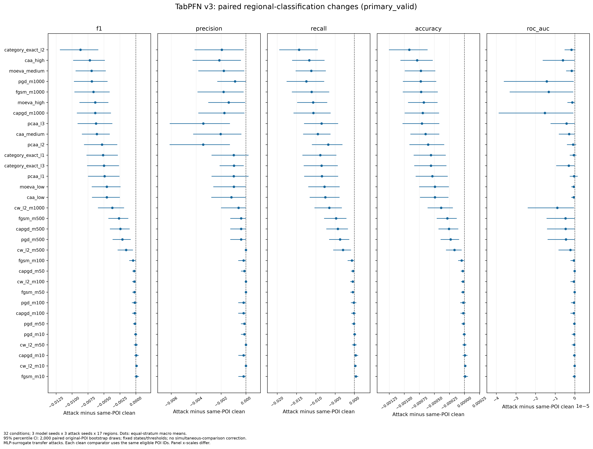
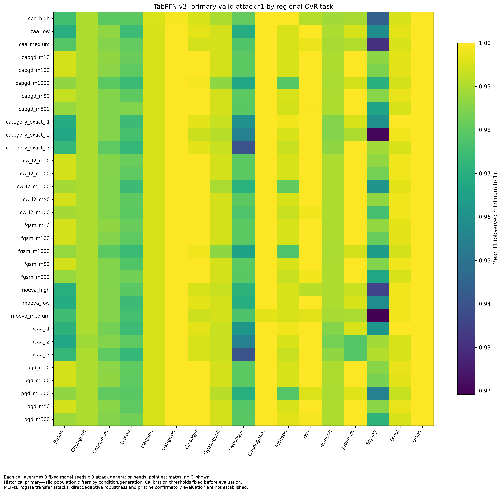

# 공격 후 지역분류 결과 — 2026-10-23

상태: **원예측·성능표·신뢰구간의 독립 수치 검수 PASS. 이 요약 문서·시각화 전달 단계는 검수 전이며 전체 연구는 PARTIAL.**

## 평가 대상과 해석

Clean 비교에서 선정한 full-feature TabPFN v3의 저장된 51개 학습 상태(3 seed × 17개 지역 OvR)를 그대로 사용했다. 평가 POI 1,707개에 대해 32개 공격 조건 × 생성 seed 3개를 평가했다. 분류 임계값은 별도 clean calibration 1,693개에서 고정했고 공격 평가로 재선정하지 않았다.

공격은 MLP surrogate를 상대로 생성한 뒤 TabPFN v3에 전이한 것이다. TabPFN v3 직접 공격이나 방어 파이프라인에 적응한 공격의 강건성을 증명하지 않는다. 지역 경계 버전과 범주 변경의 실세계 의미에 대한 기존 제한도 유지된다.

## 주요 표

아래는 기존 유효성 규칙을 통과한 `primary_valid` 표본의 결과다. 각 공격 조건의 clean 비교값은 **그 조건에서 유효한 동일 POI**로 계산한다. 조건마다 POI 집합이 달라 clean F1도 달라질 수 있다. 지역·모델 seed·공격 생성 seed의 153개 strata를 동일 가중 평균한다.

| 공격 조건 | 공격 F1 | 동일 POI clean F1 | 차이(공격−clean) | 차이의 95% CI |
|---|---:|---:|---:|---|
| caa_high | 0.987851 | 0.995062 | -0.007211 | [-0.009842, -0.004862] |
| caa_low | 0.988945 | 0.993499 | -0.004554 | [-0.006877, -0.002510] |
| caa_medium | 0.987965 | 0.994075 | -0.006111 | [-0.008466, -0.004092] |
| capgd_m10 | 0.993565 | 0.993499 | +0.000066 | [-0.000256, +0.000443] |
| capgd_m100 | 0.993315 | 0.993495 | -0.000181 | [-0.000599, +0.000133] |
| capgd_m1000 | 0.988659 | 0.995030 | -0.006371 | [-0.009248, -0.003909] |
| capgd_m50 | 0.993252 | 0.993496 | -0.000244 | [-0.000570, +0.000000] |
| capgd_m500 | 0.991863 | 0.994282 | -0.002418 | [-0.004078, -0.000969] |
| category_exact_l1 | 0.988358 | 0.993499 | -0.005141 | [-0.007750, -0.002832] |
| category_exact_l2 | 0.984816 | 0.993499 | -0.008683 | [-0.011917, -0.005890] |
| category_exact_l3 | 0.988501 | 0.993499 | -0.004998 | [-0.007652, -0.002647] |
| cw_l2_m10 | 0.993600 | 0.993499 | +0.000101 | [+0.000000, +0.000332] |
| cw_l2_m100 | 0.993273 | 0.993498 | -0.000225 | [-0.000584, +0.000000] |
| cw_l2_m1000 | 0.989544 | 0.993236 | -0.003692 | [-0.005938, -0.001847] |
| cw_l2_m50 | 0.993498 | 0.993499 | -0.000001 | [-0.000329, +0.000311] |
| cw_l2_m500 | 0.992195 | 0.993717 | -0.001521 | [-0.002857, -0.000461] |
| fgsm_m10 | 0.993603 | 0.993499 | +0.000103 | [-0.000204, +0.000473] |
| fgsm_m100 | 0.993064 | 0.993495 | -0.000431 | [-0.001050, +0.000000] |
| fgsm_m1000 | 0.988087 | 0.994737 | -0.006650 | [-0.009632, -0.004113] |
| fgsm_m50 | 0.993283 | 0.993496 | -0.000214 | [-0.000571, +0.000000] |
| fgsm_m500 | 0.991634 | 0.994282 | -0.002648 | [-0.004307, -0.001195] |
| moeva_high | 0.987214 | 0.993586 | -0.006372 | [-0.008849, -0.004317] |
| moeva_low | 0.988943 | 0.993499 | -0.004556 | [-0.006926, -0.002397] |
| moeva_medium | 0.986563 | 0.993498 | -0.006935 | [-0.009448, -0.004720] |
| pcaa_l1 | 0.988594 | 0.993499 | -0.004905 | [-0.007498, -0.002575] |
| pcaa_l2 | 0.988195 | 0.993499 | -0.005304 | [-0.008124, -0.002911] |
| pcaa_l3 | 0.987256 | 0.993499 | -0.006244 | [-0.009140, -0.003682] |
| pgd_m10 | 0.993460 | 0.993499 | -0.000039 | [-0.000290, +0.000201] |
| pgd_m100 | 0.993310 | 0.993495 | -0.000185 | [-0.000624, +0.000198] |
| pgd_m1000 | 0.988251 | 0.995147 | -0.006896 | [-0.009706, -0.004439] |
| pgd_m50 | 0.993357 | 0.993497 | -0.000141 | [-0.000458, +0.000097] |
| pgd_m500 | 0.992187 | 0.994300 | -0.002113 | [-0.003644, -0.000812] |

CI는 고정된 학습 상태와 임계값을 조건으로 한 원본 POI 단위 paired bootstrap 2,000회 percentile 구간이다. 조건별 구간은 다중 비교를 보정한 동시 신뢰구간이 아니다.

- [F1·precision·recall·accuracy·ROC-AUC 표](tables/primary_valid_classification_metrics.csv)
- [동일 POI F1 차이 표](tables/primary_valid_f1_same_poi_comparison.csv)
- [모든 조건·두 population·5개 지표 및 CI](../03_attack_effect/tables/no_defense_paired_bootstrap_intervals.csv)
- [공격 지역별 원지표](../03_attack_effect/tables/no_defense_attack_region_metrics.csv)
- [조건별 동일 POI clean 원지표](../03_attack_effect/tables/paired_clean_reference_region_metrics.csv)
- [전체 clean 1,707개 원지표](../03_attack_effect/tables/clean_full_evaluation_region_metrics.csv)

## 시각화 초안

아래 그림 8개는 검수된 표를 시각화한 PNG 300dpi 초안이다. 그림 자체의 독립 검수는 대기 중이다. 점과 CI는 이미 계산한 값을 표시하며 새 모델 추론이나 통계 검정은 수행하지 않았다.

- [전체 공격 시도 표본의 변화와 CI](figures/paired_metric_change_all_intent.png)
- 지역별 [precision](figures/regional_precision_primary_valid.png), [recall](figures/regional_recall_primary_valid.png), [accuracy](figures/regional_accuracy_primary_valid.png), [ROC-AUC](figures/regional_roc_auc_primary_valid.png)
- [유효·제외 표본 수](figures/primary_population_support.png)
- [그림별 원자료·해시·표현 범위](figure_manifest.json)

## 원예측 검수와 복구 근거

원예측 8,357,472개 공격 score와 87,057개 clean score, 19,635개 지표 행, 640,000개 저장 bootstrap replicate 및 320개 CI를 독립 대조했다. 원예측으로 직접 다시 만든 bootstrap은 사전에 정한 90개 macro replicate에 한정하며, 전체 2,000회 재추론을 뜻하지 않는다.

기존 실행은 ROC-AUC/AP가 IEEE-754 계산 오차로 1을 극미하게 넘는 값 때문에 종료 검증에서 실패했다. 274개 경계 초과 셀만 보정했고 원예측·모델·임계값·bootstrap은 변경하지 않았다. 기존 실패본은 보존했다. CPU에서 저장된 증거를 검증한 것이며 새 GPU 추론을 수행했다고 주장하지 않는다.

- [독립 수치 검수](../99_independent_review/attack_terminal_repair_actual_revision14_20261023/report.md)
- [복구 기록](../../provenance/attack_defense_revision14/repair_receipt.json)
- [R2 다운로드 SHA-256 확인](../../provenance/attack_defense_revision14/r2_preservation_receipt.json)

## 남은 작업

PNG 8개와 이 요약 문서의 독립 전달 검수는 아직 수행하지 않았다. confusion matrix·PR·ROC 곡선 전달물도 별도 보완 대상이다. 두 탐지기 후 실제 통과 표본 재추론, coverage와 전체 표본 복원 비교, 추가 설명·ablation·앙상블·민감도 분석은 후속 작업이다. 잠금 test는 이번 단계에서 읽거나 평가하지 않았다. 전체 연구 완료로 해석하지 않는다.
